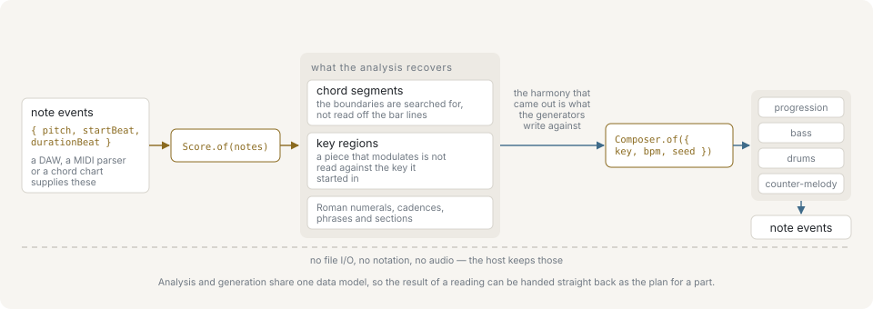

# libcantus

[](https://github.com/libraz/libcantus/actions)
[](https://www.npmjs.com/package/@libraz/libcantus)
[](https://pypi.org/project/libcantus/)
[](https://codecov.io/gh/libraz/libcantus)
[](LICENSE)
[](https://en.cppreference.com/w/cpp/17)
[](https://www.typescriptlang.org/)
[](https://github.com/libraz/libcantus)
[](https://libraz.github.io/libcantus/)

**libcantus detects chords, keys, Roman numerals and cadences in MIDI note events, and writes new parts against that same harmonic reading.**

It is a music theory library for TypeScript, JavaScript (WebAssembly), Python, Node, C++ and the command line. One specification has a pure TypeScript reference implementation and a C++17 core under it. Every surface gives the same results and the same errors, and the surfaces over the core give the same floating-point bits on every platform.

📖 **[Documentation](docs/en/introduction.md)** &nbsp;·&nbsp; **[Getting started](docs/en/getting-started.md)** &nbsp;·&nbsp; **[Packages and surfaces](docs/en/packages.md)**



## What's inside

- **Harmony from notes** — chord and key detection, Roman numerals, cadences, modulation and form from MIDI notes. [Analysis](docs/en/analysis.md)
- **Parts against the harmony** — progressions, bass, counter-melody, drums and motifs, seeded and reproducible. [Generation](docs/en/generation.md)
- **Theory vocabulary** — notes, intervals, scales, chords, voicing, part-writing and counterpoint checks. [Harmony](docs/en/harmony.md)
- **Playability** — instrument profiles, transposition and range checks. [Instruments](docs/en/instruments-and-playability.md)
- **Evidence in answers** — each reading carries its rationale and the readings it turned down; an undecidable question comes back `null`. [Analysis](docs/en/analysis.md)

## Surfaces

| Surface | Package | Page |
| --- | --- | --- |
| TypeScript (reference) | `@libraz/libcantus` | [`ts/`](ts/README.md) |
| C++ | CMake package `cantus` | [C++ core](docs/en/cpp.md) |
| WebAssembly | `@libraz/libcantus-wasm` | [`bindings/wasm/`](bindings/wasm/README.md) |
| Node native | `@libraz/libcantus-node` (built from source) | [`bindings/node/`](bindings/node/README.md) |
| Python | `libcantus` | [`bindings/python/`](bindings/python/README.md) |
| Command line | `cantus` | [Command line](docs/en/cli.md) |

The TypeScript package is synchronous, dependency-free and tree-shakeable. The other surfaces call the C++ core and differ from it only in small, documented ways ([C++ core and surface differences](docs/en/cpp.md)).

## Installation

```sh
yarn add @libraz/libcantus        # TypeScript, Node.js 22 or later
yarn add @libraz/libcantus-wasm   # WebAssembly, ESM only, the same API and types
pip install libcantus             # Python 3.10 or later
```

The Node native addon builds from a checkout (`make build-node`), the `cantus` command-line tool is a release asset on GitHub, and C++ takes CMake 3.24 and a C++17 compiler:

```cmake
include(FetchContent)
FetchContent_Declare(cantus GIT_REPOSITORY https://github.com/libraz/libcantus.git GIT_TAG main)
FetchContent_MakeAvailable(cantus)
target_link_libraries(app PRIVATE cantus::cantus)
```

`find_package(cantus)` against an installed prefix and `add_subdirectory` work the same way.

## Quick start

Each example reads the chord of C, E and G. Runnable versions are in [`examples/`](examples) and run with `make examples`; the browser example there is a bundler template that `make examples` does not run.

### TypeScript

```ts
import { detectChordBest } from '@libraz/libcantus';

detectChordBest([60, 64, 67]); // { rootPc: 0, quality: 'maj', intervals: [0, 4, 7] }
```

→ [Getting started](docs/en/getting-started.md)

### JavaScript (WASM)

```js
import { detectChordBest } from '@libraz/libcantus-wasm';

detectChordBest([60, 64, 67]);
```

Code that imports `@libraz/libcantus` can switch to it without edits, through a package-manager or bundler alias.

→ [Switching between pure TypeScript and WebAssembly](docs/en/packages.md#switching-between-pure-typescript-and-webassembly)

### Node native

```js
import { detectChordBest } from '@libraz/libcantus-node';

detectChordBest([60, 64, 67]);
```

→ [Packages and surfaces](docs/en/packages.md)

### Python

```python
import libcantus

libcantus.detect_chord_best([60, 64, 67])
```

→ [Python](docs/en/python.md)

### Command line

```sh
cantus detectChordBest '[[60, 64, 67]]'
```

→ [Command line](docs/en/cli.md)

### C++

```cpp
#include <cantus/cantus.h>

auto matches = cantus::detect_chord({60, 64, 67});
```

→ [C++ core](docs/en/cpp.md)

## Build from source

```sh
make build         # C++ core, command-line tool and tests in build/
make test-cxx      # run the C++ tests
make wasm          # WebAssembly package (needs Emscripten)
make build-node    # Node-API addon
make build-shared  # shared library for the Python binding
make examples      # build and run the examples in examples/ (not the browser one)
```

The toolchain pins and every check a change runs through are in [CONTRIBUTING.md](CONTRIBUTING.md).

## Related projects

- **[libsonare](https://github.com/libraz/libsonare)** — the audio layer below libcantus: analysis, mastering, synthesis and Standard MIDI File I/O for C++, Python, Node.js and WebAssembly ([libsonare.libraz.net](https://libsonare.libraz.net)). The two share no code and neither requires the other.
- **[sonare studio](https://sonare-studio.libraz.net)** — a browser-based DAW whose music theory and composition features come from `@libraz/libcantus` and whose audio runs on libsonare. A hosted live demo, not a production product.
- **[midi-sketch](https://github.com/libraz/midi-sketch)** — a rule-based pop MIDI generator built on `@libraz/libcantus`.

## Documentation

The documentation is Markdown in [`docs/en/`](docs/en/introduction.md), with the same pages in Japanese under [`docs/ja/`](docs/ja/introduction.md); the symbol reference is generated at [libraz.github.io/libcantus](https://libraz.github.io/libcantus/).

- **Learn** — [Primer](docs/en/primer/index.md) · [Introduction](docs/en/introduction.md) · [Getting started](docs/en/getting-started.md) · [Use cases](docs/en/use-cases/index.md)
- **Guides** — [Analysis](docs/en/analysis.md) · [Generation](docs/en/generation.md) · [Harmony](docs/en/harmony.md) · [Voicing](docs/en/voicing.md) · [Rhythm and groove](docs/en/rhythm-and-groove.md) · the other domain pages listed in [API reference](docs/en/api-reference.md)
- **Surfaces** — [Packages and surfaces](docs/en/packages.md) · [C++ core](docs/en/cpp.md) · [Python](docs/en/python.md) · [Command line](docs/en/cli.md)
- **Reference** — [Errors and validation](docs/en/errors-and-validation.md) · [Glossary](docs/en/glossary.md) · [Questions and limitations](docs/en/faq.md)

## Non-goals

- **No I/O, notation or audio.** No MIDI file reader or writer, no score rendering, no audio analysis, no playback. Bring your own parser and hand it note events. For the layer below, [libsonare](https://github.com/libraz/libsonare) covers audio analysis, mastering, synthesis and SMF I/O; the two share no code and neither requires the other.
- **No microtonal analysis.** Frequencies, cents and just-intonation ratios live in `core`, but everything above the pitch layer runs on twelve pitch classes.
- **No rāga or maqām-style modal grammars.** `WORLD_SCALES` records the pitch material a tradition names, not the grammar built on it.
- **No corpus.** Nothing is bundled to run statistics over.

## License

[Apache-2.0](LICENSE)
