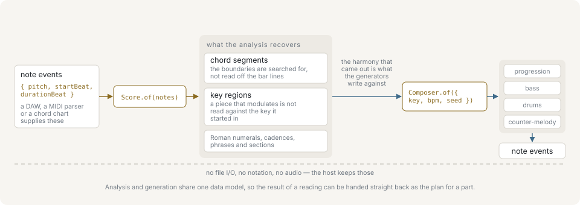

# libcantus

[](https://github.com/libraz/libcantus/actions)
[](https://www.npmjs.com/package/@libraz/libcantus)
[](https://pypi.org/project/libcantus/)
[](https://codecov.io/gh/libraz/libcantus)
[](LICENSE)
[](https://isocpp.org/)
[](https://www.typescriptlang.org/)
[](https://github.com/libraz/libcantus)
[](https://libraz.github.io/libcantus/)

**Music theory for MIDI note events: recover the harmony from notes, and write new parts against that same reading.**

One specification, a pure TypeScript reference implementation and a C++17 core under it, reachable from C++, WebAssembly, Node, Python and the command line. Every surface gives the same results, the same errors and the same floating-point bits.

**[Documentation](docs/en/introduction.md)** · **[Getting started](docs/en/getting-started.md)** · **[Packages and surfaces](docs/en/packages.md)**



## What's inside

- **Harmony from notes.** Chord and key detection, Roman numerals, cadences, modulation, form. [Analysis](docs/en/analysis.md)
- **Parts against the harmony.** Progressions, bass, counter-melody, drums, motifs, seeded and reproducible. [Generation](docs/en/generation.md)
- **Theory vocabulary.** Notes, intervals, scales, chords, voicing, part-writing and counterpoint checks. [Harmony](docs/en/harmony.md)
- **Playability.** Instrument profiles, transposition and range checks. [Instruments](docs/en/instruments-and-playability.md)
- **Evidence in answers.** Each reading carries its rationale and the readings it turned down; an undecidable question comes back `null`.

## Surfaces

| Surface | Package | Page |
| --- | --- | --- |
| TypeScript (reference) | `@libraz/libcantus` | [`ts/`](ts/README.md) |
| C++ | CMake package `cantus` | [C++ core](docs/en/cpp.md) |
| WebAssembly | `@libraz/libcantus-wasm` | [`bindings/wasm/`](bindings/wasm/README.md) |
| Node native | `@libraz/libcantus-node` (built from source) | [`bindings/node/`](bindings/node/README.md) |
| Python | `libcantus` | [`bindings/python/`](bindings/python/README.md) |
| Command line | `cantus` | [Command line](docs/en/cli.md) |

The TypeScript package is synchronous, dependency-free and tree-shakeable. The other surfaces call the C++ core and differ from it only in small, documented ways ([C++ core and surface differences](docs/en/cpp.md)).

## Installation and quick start

Each example reads the chord of C, E and G.

**TypeScript**, Node.js 22 or later:

```sh
yarn add @libraz/libcantus
```

```ts
import { detectChordBest } from '@libraz/libcantus';

detectChordBest([60, 64, 67]); // { rootPc: 0, quality: 'maj', intervals: [0, 4, 7] }
```

**WebAssembly**, ESM only; the same API and types:

```sh
yarn add @libraz/libcantus-wasm
```

```js
import { detectChordBest } from '@libraz/libcantus-wasm';

detectChordBest([60, 64, 67]);
```

**Node native**, from a checkout (`make build-node`):

```js
import { detectChordBest } from '@libraz/libcantus-node';

detectChordBest([60, 64, 67]);
```

**Python**, 3.10 or later:

```sh
pip install libcantus
```

```python
import libcantus

libcantus.detect_chord_best([60, 64, 67])
```

**Command line**, a release asset from GitHub:

```sh
cantus detectChordBest '[[60, 64, 67]]'
```

**C++**, CMake 3.24 and a C++17 compiler:

```cmake
include(FetchContent)
FetchContent_Declare(cantus GIT_REPOSITORY https://github.com/libraz/libcantus.git GIT_TAG main)
FetchContent_MakeAvailable(cantus)
target_link_libraries(app PRIVATE cantus::cantus)
```

```cpp
#include <cantus/cantus.h>

auto matches = cantus::detect_chord({60, 64, 67});
```

`find_package(cantus)` against an installed prefix and `add_subdirectory` work the same way. Runnable versions of these examples are in [`examples/`](examples) and run with `make examples`; the browser example there is a bundler template that `make examples` does not run.

## Building from source

```sh
make build         # C++ core, command-line tool and tests in build/
make test-cxx      # run the C++ tests
make wasm          # WebAssembly package (needs Emscripten)
make build-node    # Node-API addon
make build-shared  # shared library for the Python binding
make examples      # build and run the examples in examples/ (not the browser one)
```

## Documentation

- **Learn:** [Primer](docs/en/primer/index.md) for the music theory, [Introduction](docs/en/introduction.md), [Getting started](docs/en/getting-started.md), and [Use cases](docs/en/use-cases/index.md) for complete flows.
- **Guides:** [Analysis](docs/en/analysis.md), [Generation](docs/en/generation.md), [Harmony](docs/en/harmony.md), [Voicing](docs/en/voicing.md), [Rhythm and groove](docs/en/rhythm-and-groove.md) and the other domain pages listed in [API reference](docs/en/api-reference.md).
- **Surfaces:** [Packages and surfaces](docs/en/packages.md), [C++ core](docs/en/cpp.md), [Python](docs/en/python.md), [Command line](docs/en/cli.md).
- **Reference:** [Errors and validation](docs/en/errors-and-validation.md), [Glossary](docs/en/glossary.md), [Questions and limitations](docs/en/faq.md).

The pages are also in Japanese under [`docs/ja/`](docs/ja/introduction.md). Contributor rules are in [CONTRIBUTING.md](CONTRIBUTING.md).

## What it doesn't do

- **No I/O, notation or audio.** No MIDI file reader or writer, no score rendering, no audio analysis, no playback. Bring your own parser and hand it note events. For the layer below, [libsonare](https://github.com/libraz/libsonare) covers audio analysis, mastering, synthesis and SMF I/O; the two share no code and neither requires the other.
- **No microtonal analysis.** Frequencies, cents and just-intonation ratios live in `core`, but everything above the pitch layer runs on twelve pitch classes.
- **No rāga or maqām-style modal grammars.** `WORLD_SCALES` records the pitch material a tradition names, not the grammar built on it.
- **No corpus.** Nothing is bundled to run statistics over.

## License

[Apache License 2.0](LICENSE).
