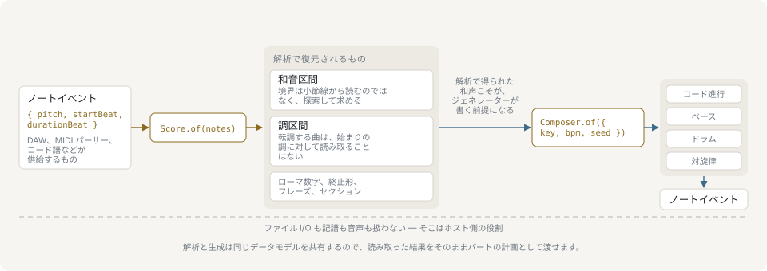

# libcantus

[](https://github.com/libraz/libcantus/actions)
[](https://www.npmjs.com/package/@libraz/libcantus)
[](https://pypi.org/project/libcantus/)
[](https://codecov.io/gh/libraz/libcantus)
[](LICENSE)
[](https://en.cppreference.com/w/cpp/17)
[](https://www.typescriptlang.org/)
[](https://github.com/libraz/libcantus)
[](https://libraz.github.io/libcantus/)

**libcantus は MIDI のノートイベントからコード、調、ローマ数字、終止形を検出し、その和声の読みに沿って新しいパートを書きます。**

TypeScript、JavaScript（WebAssembly）、Python、Node、C++、コマンドラインから使える音楽理論ライブラリです。仕様は 1 つで、リファレンス実装の純 TypeScript と、その下にある C++17 のコアがあります。どの面でも結果とエラーは同じです。コアの上にある面どうしは、どのプラットフォームでも浮動小数のビット列まで一致します。

📖 **[ドキュメント](docs/ja/introduction.md)** &nbsp;·&nbsp; **[使いはじめる](docs/ja/getting-started.md)** &nbsp;·&nbsp; **[パッケージ構成](docs/ja/packages.md)**



## できること

- **ノートから和声を読む** — コードと調の検出、ローマ数字、終止形、転調、形式。[解析](docs/ja/analysis.md)
- **和声に沿ってパートを書く** — コード進行、ベース、カウンターメロディ、ドラム、モチーフ。シードを固定すれば再現できます。[生成](docs/ja/generation.md)
- **理論の語彙** — 音、音程、スケール、コード、ヴォイシング、声部書法と対位法のチェック。[和声](docs/ja/harmony.md)
- **演奏可能性** — 楽器プロファイル、移調、音域のチェック。[楽器と演奏可能性](docs/ja/instruments-and-playability.md)
- **答えに根拠が付く** — 読みごとに根拠と、退けた読みが付きます。決められない問いには `null` が返ります。[解析](docs/ja/analysis.md)

## 面

| 面 | パッケージ | ページ |
| --- | --- | --- |
| TypeScript（リファレンス） | `@libraz/libcantus` | [`ts/`](ts/README_ja.md) |
| C++ | CMake パッケージ `cantus` | [C++ コア](docs/ja/cpp.md) |
| WebAssembly | `@libraz/libcantus-wasm` | [`bindings/wasm/`](bindings/wasm/README.md) |
| Node ネイティブ | `@libraz/libcantus-node`（ソースからビルド） | [`bindings/node/`](bindings/node/README.md) |
| Python | `libcantus` | [`bindings/python/`](bindings/python/README.md) |
| コマンドライン | `cantus` | [コマンドライン](docs/ja/cli.md) |

TypeScript パッケージは同期 API で、依存がなく、ツリーシェイキングできます。ほかの面は C++ コアを呼び出し、小さな差が文書化されているだけで、挙動は同じです（[C++ コアと面ごとの差](docs/ja/cpp.md)）。

## インストール

```sh
yarn add @libraz/libcantus        # TypeScript（Node.js 22 以降）
yarn add @libraz/libcantus-wasm   # WebAssembly（ESM のみ。API と型は同じ）
pip install libcantus             # Python 3.10 以降
```

Node ネイティブアドオンはチェックアウトからビルドし（`make build-node`）、コマンドラインツール `cantus` は GitHub のリリース資産です。C++ には CMake 3.24 と C++17 のコンパイラが必要です。

```cmake
include(FetchContent)
FetchContent_Declare(cantus GIT_REPOSITORY https://github.com/libraz/libcantus.git GIT_TAG main)
FetchContent_MakeAvailable(cantus)
target_link_libraries(app PRIVATE cantus::cantus)
```

インストール済みのプレフィックスに対する `find_package(cantus)` や `add_subdirectory` でも同じように使えます。

## クイックスタート

どの例も、C・E・G の和音を読みます。実行できる形にしたものが [`examples/`](examples) にあり、`make examples` で実行できます。ただしブラウザ向けの例はバンドラ用のテンプレートで、`make examples` では実行されません。

### TypeScript

```ts
import { detectChordBest } from '@libraz/libcantus';

detectChordBest([60, 64, 67]); // { rootPc: 0, quality: 'maj', intervals: [0, 4, 7] }
```

→ [使いはじめる](docs/ja/getting-started.md)

### JavaScript（WASM）

```js
import { detectChordBest } from '@libraz/libcantus-wasm';

detectChordBest([60, 64, 67]);
```

`@libraz/libcantus` を import しているコードは、パッケージマネージャかバンドラのエイリアスで、書き換えずにこちらへ切り替えられます。

→ [純 TypeScript と WebAssembly の切り替え](docs/ja/packages.md#純-typescript-と-webassembly-の切り替え)

### Node ネイティブ

```js
import { detectChordBest } from '@libraz/libcantus-node';

detectChordBest([60, 64, 67]);
```

→ [パッケージ構成](docs/ja/packages.md)

### Python

```python
import libcantus

libcantus.detect_chord_best([60, 64, 67])
```

→ [Python](docs/ja/python.md)

### コマンドライン

```sh
cantus detectChordBest '[[60, 64, 67]]'
```

→ [コマンドライン](docs/ja/cli.md)

### C++

```cpp
#include <cantus/cantus.h>

auto matches = cantus::detect_chord({60, 64, 67});
```

→ [C++ コア](docs/ja/cpp.md)

## ソースからビルド

```sh
make build         # C++ コア、コマンドラインツール、テストを build/ に作る
make test-cxx      # C++ テストを実行する
make wasm          # WebAssembly パッケージ（Emscripten が必要）
make build-node    # Node-API アドオン
make build-shared  # Python バインディング用の共有ライブラリ
make examples      # examples/ の例をビルドして実行する（ブラウザ向けを除く）
```

ツールチェーンの固定と、変更が通るチェックの一覧は [CONTRIBUTING.md](CONTRIBUTING.md) にあります。

## 関連プロジェクト

- **[libsonare](https://github.com/libraz/libsonare)** — libcantus の下にある音声の層です。音声解析、マスタリング、合成、Standard MIDI File の入出力を C++、Python、Node.js、WebAssembly から使えます（[libsonare.libraz.net](https://libsonare.libraz.net/ja/)）。両者はコードを共有せず、どちらも相手を必要としません。
- **[sonare studio](https://sonare-studio.libraz.net)** — ブラウザで動く DAW で、音楽理論と作曲機能は `@libraz/libcantus`、音声処理は libsonare で動いています。ホスト済みのライブデモで、製品ではありません。ソース: [libraz/sonare-studio](https://github.com/libraz/sonare-studio)。
- **[midi-sketch](https://github.com/libraz/midi-sketch)** — `@libraz/libcantus` を使った、ルールベースのポップス向け MIDI ジェネレーターです。

## ドキュメント

ドキュメントは [`docs/ja/`](docs/ja/introduction.md) にある Markdown で、英語版は [`docs/en/`](docs/en/introduction.md) にあります。シンボルのリファレンスは [libraz.github.io/libcantus](https://libraz.github.io/libcantus/) に生成されています。

- **学ぶ** — [入門](docs/ja/primer/index.md) · [はじめに](docs/ja/introduction.md) · [使いはじめる](docs/ja/getting-started.md) · [ユースケース](docs/ja/use-cases/index.md)
- **ガイド** — [解析](docs/ja/analysis.md) · [生成](docs/ja/generation.md) · [和声](docs/ja/harmony.md) · [ヴォイシング](docs/ja/voicing.md) · [リズムとグルーヴ](docs/ja/rhythm-and-groove.md) · そのほかの分野別ページは [API リファレンス](docs/ja/api-reference.md)に一覧があります
- **各面** — [パッケージ構成](docs/ja/packages.md) · [C++ コア](docs/ja/cpp.md) · [Python](docs/ja/python.md) · [コマンドライン](docs/ja/cli.md)
- **リファレンス** — [エラーと検証](docs/ja/errors-and-validation.md) · [用語集](docs/ja/glossary.md) · [疑問と制限](docs/ja/faq.md)

## 含まないもの（Non-goals）

- **入出力、記譜、音声は扱いません。** MIDI ファイルの読み書き、楽譜の描画、音声解析、再生はありません。パーサは各自で用意し、ノートイベントを渡してください。その下の層は [libsonare](https://github.com/libraz/libsonare) が、音声解析、マスタリング、合成、SMF の入出力を担当します。両者はコードを共有せず、どちらも相手を必要としません。
- **微分音の解析はしません。** 周波数、セント、純正律の比率は `core` にありますが、ピッチ層より上は 12 ピッチクラスで動きます。
- **ラーガやマカームのような旋法の文法は扱いません。** `WORLD_SCALES` が記録するのは各伝統が名指す音高の素材で、その上に築かれた文法ではありません。
- **コーパスは含みません。** 統計を取るためのデータは同梱していません。

## ライセンス

[Apache-2.0](LICENSE)
