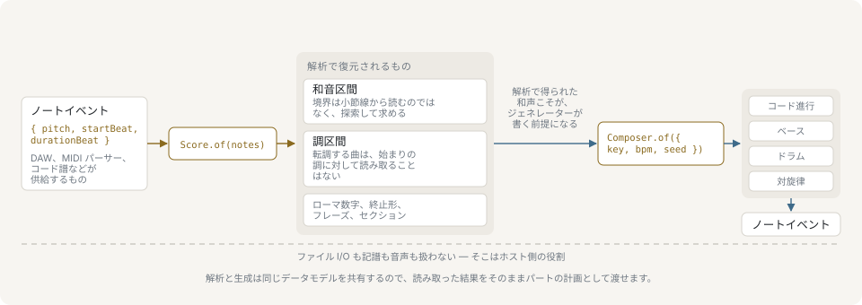

# libcantus

[](https://github.com/libraz/libcantus/actions)
[](https://www.npmjs.com/package/@libraz/libcantus)
[](https://pypi.org/project/libcantus/)
[](https://codecov.io/gh/libraz/libcantus)
[](LICENSE)
[](https://isocpp.org/)
[](https://www.typescriptlang.org/)
[](https://github.com/libraz/libcantus)
[](https://libraz.github.io/libcantus/)

**MIDI のノートイベントのための音楽理論ライブラリです。ノートから和声を読み取り、その読みに沿って新しいパートを書きます。**

仕様は 1 つで、リファレンス実装の純 TypeScript と、その下にある C++17 のコアを、C++、WebAssembly、Node、Python、コマンドラインから呼び出せます。どの面でも、結果、エラー、浮動小数のビット列が同じになります。

**[ドキュメント](docs/ja/introduction.md)** · **[使いはじめる](docs/ja/getting-started.md)** · **[パッケージ構成](docs/ja/packages.md)**



## 主な機能

- **ノートから和声を読む。** コードと調の検出、ローマ数字、終止形、転調、形式。[解析](docs/ja/analysis.md)
- **和声に沿ってパートを書く。** コード進行、ベース、カウンターメロディ、ドラム、モチーフ。シードを固定すれば再現できます。[生成](docs/ja/generation.md)
- **理論の語彙。** 音、音程、スケール、コード、ヴォイシング、声部書法と対位法のチェック。[和声](docs/ja/harmony.md)
- **演奏可能性。** 楽器プロファイル、移調、音域のチェック。[楽器と演奏可能性](docs/ja/instruments-and-playability.md)
- **答えに根拠が付く。** 読みごとに根拠と、退けた読みが付きます。決められない問いには `null` が返ります。

## 面

| 面 | パッケージ | ページ |
| --- | --- | --- |
| TypeScript（リファレンス） | `@libraz/libcantus` | [`ts/`](ts/README_ja.md) |
| C++ | CMake パッケージ `cantus` | [C++ コア](docs/ja/cpp.md) |
| WebAssembly | `@libraz/libcantus-wasm` | [`bindings/wasm/`](bindings/wasm/README.md) |
| Node ネイティブ | `@libraz/libcantus-node`（ソースからビルド） | [`bindings/node/`](bindings/node/README.md) |
| Python | `libcantus` | [`bindings/python/`](bindings/python/README.md) |
| コマンドライン | `cantus` | [コマンドライン](docs/ja/cli.md) |

TypeScript パッケージは同期 API で、依存がなく、ツリーシェイキングできます。ほかの面は C++ コアを呼び出し、小さな差が文書化されているだけで、挙動は同じです（[C++ コアと面ごとの差](docs/ja/cpp.md)）。

## インストールと最小の例

どの例も、C・E・G の和音を読みます。

**TypeScript**（Node.js 22 以降）:

```sh
yarn add @libraz/libcantus
```

```ts
import { detectChordBest } from '@libraz/libcantus';

detectChordBest([60, 64, 67]); // { rootPc: 0, quality: 'maj', intervals: [0, 4, 7] }
```

**WebAssembly**（ESM のみ。API と型は同じです）:

```sh
yarn add @libraz/libcantus-wasm
```

```js
import { detectChordBest } from '@libraz/libcantus-wasm';

detectChordBest([60, 64, 67]);
```

**Node ネイティブ**（チェックアウトから。`make build-node`）:

```js
import { detectChordBest } from '@libraz/libcantus-node';

detectChordBest([60, 64, 67]);
```

**Python**（3.10 以降）:

```sh
pip install libcantus
```

```python
import libcantus

libcantus.detect_chord_best([60, 64, 67])
```

**コマンドライン**（GitHub のリリース資産）:

```sh
cantus detectChordBest '[[60, 64, 67]]'
```

**C++**（CMake 3.24 と C++17 のコンパイラ）:

```cmake
include(FetchContent)
FetchContent_Declare(cantus GIT_REPOSITORY https://github.com/libraz/libcantus.git GIT_TAG main)
FetchContent_MakeAvailable(cantus)
target_link_libraries(app PRIVATE cantus::cantus)
```

```cpp
#include <cantus/cantus.h>

auto matches = cantus::detect_chord({60, 64, 67});
```

インストール済みのプレフィックスに対する `find_package(cantus)` や `add_subdirectory` でも同じように使えます。これらの例を実行できる形にしたものが [`examples/`](examples) にあり、`make examples` で実行できます。

## ソースからのビルド

```sh
make build         # C++ コア、コマンドラインツール、テストを build/ に作る
make test-cxx      # C++ テストを実行する
make wasm          # WebAssembly パッケージ（Emscripten が必要）
make build-node    # Node-API アドオン
make build-shared  # Python バインディング用の共有ライブラリ
make examples      # examples/ 以下をすべてビルドして実行する
```

## ドキュメント

- **学ぶ:** 音楽理論は[入門](docs/ja/primer/index.md)、全体像は[はじめに](docs/ja/introduction.md)と[使いはじめる](docs/ja/getting-started.md)、一連の流れは[ユースケース](docs/ja/use-cases/index.md)。
- **ガイド:** [解析](docs/ja/analysis.md)、[生成](docs/ja/generation.md)、[和声](docs/ja/harmony.md)、[ヴォイシング](docs/ja/voicing.md)、[リズムとグルーヴ](docs/ja/rhythm-and-groove.md)。そのほかの分野別ページは [API リファレンス](docs/ja/api-reference.md)に一覧があります。
- **各面:** [パッケージ構成](docs/ja/packages.md)、[C++ コア](docs/ja/cpp.md)、[Python](docs/ja/python.md)、[コマンドライン](docs/ja/cli.md)。
- **リファレンス:** [エラーと検証](docs/ja/errors-and-validation.md)、[用語集](docs/ja/glossary.md)、[疑問と制限](docs/ja/faq.md)。

ページは英語版も [`docs/en/`](docs/en/introduction.md) にあります。コントリビューター向けの規則は [CONTRIBUTING.md](CONTRIBUTING.md) にあります。

## できないこと

- **入出力、記譜、音声は扱いません。** MIDI ファイルの読み書き、楽譜の描画、音声解析、再生はありません。パーサは各自で用意し、ノートイベントを渡してください。その下の層は [libsonare](https://github.com/libraz/libsonare) が、音声解析、マスタリング、合成、SMF の入出力を担当します。両者はコードを共有せず、どちらも相手を必要としません。
- **微分音の解析はしません。** 周波数、セント、純正律の比率は `core` にありますが、ピッチ層より上は 12 ピッチクラスで動きます。
- **旋法体系は扱いません。** `WORLD_SCALES` が記録するのは各伝統が名指す音高の素材で、その上に築かれた文法ではありません。
- **コーパスは含みません。** 統計を取るためのデータは同梱していません。

## ライセンス

[Apache License 2.0](LICENSE) で公開しています。
